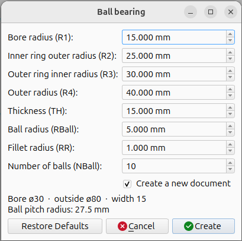
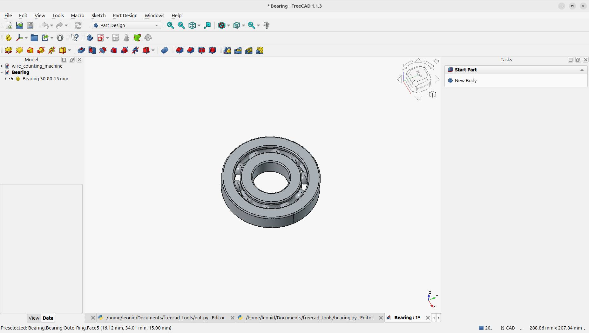
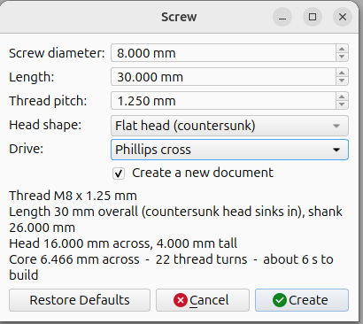
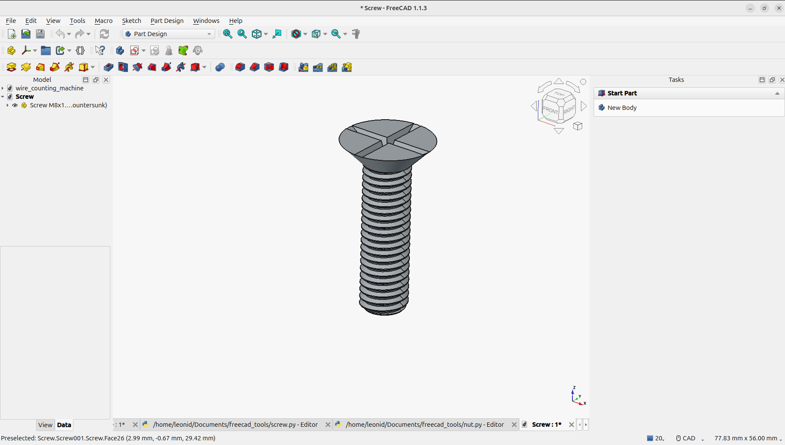
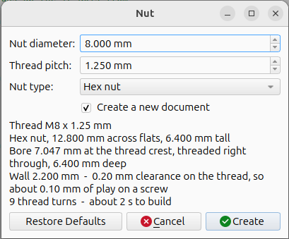
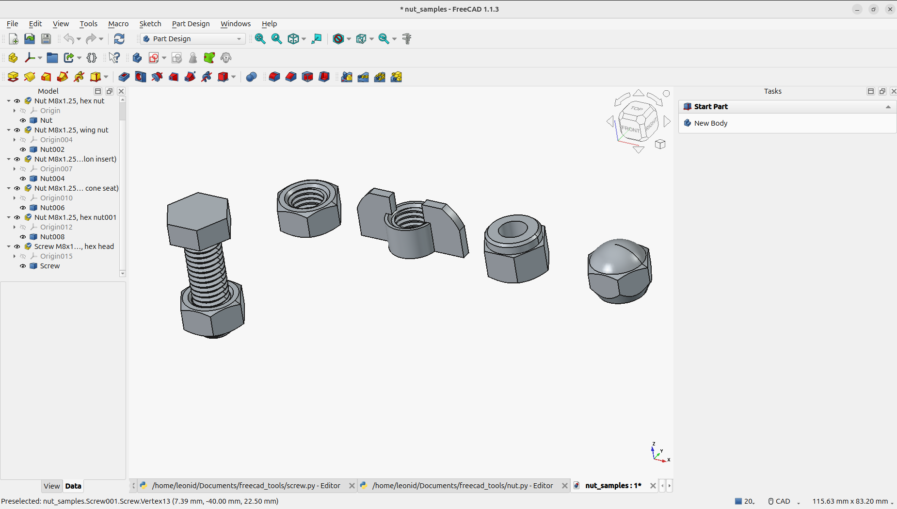
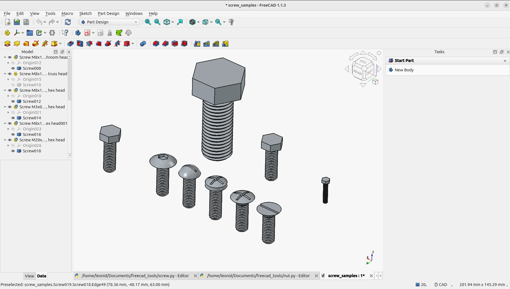

# FreeCAD tools

Parametric part generators for FreeCAD - a ball bearing, a screw and a nut.
Each is a single-file macro with a parameter dialog. Tested on FreeCAD 1.1.3.

## Install

Copy the `.py` file into your FreeCAD macro directory (Macro -> Macros... shows
the path), then Macro -> Macros... -> select it -> Execute.

Every dialog previews the derived sizes as you type, refuses values that cannot
be built, and can put the part in a new document or the active one.

## `bearing.py` - ball bearing

Two rings, a race groove and a ring of balls. You set all eight dimensions, so
it is not tied to a standard size.

Fill in: bore radius R1, inner ring outer radius R2, outer ring inner radius
R3, outer radius R4, thickness TH, ball radius, fillet radius (0 = none) and
the number of balls. These are radii, not diameters - the defaults make a
30 x 80 x 15 mm bearing.




## `screw.py` - screw with a modelled thread

Real ISO metric thread geometry, seven head shapes and four drive recesses.

Fill in: diameter, length, pitch, head shape (flat, oval, pan, round,
mushroom, truss, hex) and drive (none, slot, Phillips, hex socket). Head sizes
come from the diameter as rounded ISO/DIN ratios. `Length` is the shank under
the head, except on the countersunk flat and oval heads, where it is overall.
The thread is built one turn at a time, about a quarter second per turn, and
the dialog shows the turn count and an estimate.




## `nut.py` - nut with a modelled internal thread

The same thread in its internal form, in four body styles: a **hex** nut with
chamfered bearing faces, a **wing** nut, a **lock** nut with a nylon-insert
collar the screw cuts its own path through, and a closed-end **lug** nut with a
60 degree cone seat.

Fill in: diameter, pitch and nut type. Everything else - across flats, height,
wall thickness, wing span, collar, cone seat - follows from the diameter as
rounded ISO/DIN ratios, so an M8 hex nut comes out 12.8 x 6.4 mm. Hex and wing
nuts are threaded right through; lock and lug nuts are closed at the top, so
their thread is blind.

The thread carries 0.2 mm of radial clearance, about 0.1 mm of play on a screw.
A nut and a `screw.py` screw of the same diameter and pitch share one thread
phase, so they mate without any hand alignment - the pair on the left below.
A nut is only a few turns and builds in about a second.




## Samples

`samples/screw_samples.FCStd` holds all seven head shapes plus the thread at
M3, M8 and M20; `samples/nut_samples.FCStd` holds all four nut styles and an M8
screw seated in a hex nut. Regenerate with:

```bash
flatpak run --command=freecadcmd org.freecad.FreeCAD tools/make_samples.py
```



## Without the GUI

```python
import bearing, screw, nut
bearing.build_bearing(dict(bearing.DEFAULTS, R1=10.0, R4=30.0, TH=9.0))
screw.build_screw(dict(screw.DEFAULTS, diameter=6.0, length=20.0, head="hex"))
nut.build_nut(dict(nut.DEFAULTS, diameter=8.0, pitch=1.25, kind="hex"))
```

## Tests

Plain scripts under `tests/`, since there is no pytest inside the FreeCAD
Flatpak. Each prints a `RESULT:` line:

```bash
flatpak run --command=freecadcmd org.freecad.FreeCAD tests/test_screw.py 2>&1 | grep RESULT
```

The two dialog tests need the GUI binary and write their result to the file
named by `HARNESS_OUT`; see the top of `tests/test_dialog.py`.
